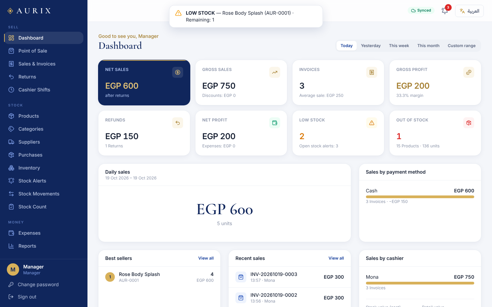

# AURIX — POS, Inventory & Store Management

Bilingual (English / العربية) point of sale and inventory system for **AURIX** — accessories, body splash, perfumes and beauty products.

**No server.** The app is a static site on **GitHub Pages**; the backend is **Google Apps Script** and the database is a **Google Spreadsheet** (17 tabs) that the manager can open at any time.

| Manager dashboard | Cashier POS (tablet, Arabic RTL) |
|---|---|
|  |  |

## How it works

```
Tablet / laptop / phone ── HTTPS (POST JSON) ──► Apps Script web app ──► Google Spreadsheet
   React app on GitHub Pages                       • session tokens (HMAC-signed)       Settings, Users, Products, Categories,
   EN/AR, RTL, receipts 58/80 mm                   • permissions checked on every call  Suppliers, Sales, SaleItems, Purchases,
                                                   • LockService: one writer at a time  PurchaseItems, StockMovements, Returns,
                                                   • validate first, then write         ReturnItems, Expenses, CashierShifts,
                                                   • idempotent transaction IDs         CashMovements, InventoryAlerts, AuditLogs
```

How Sheets is made safe enough for money and stock:

| Risk | Protection |
|---|---|
| Two tablets sell the last unit | Every write runs under `LockService`; stock is re-checked inside the lock. Selling below zero is impossible. |
| Half-written sale | Each request validates **everything** first and only buffers writes; the buffer is written at the end. A rejected sale writes nothing (tested). |
| Network drop / double tap | Each sale has a client transaction ID. Retrying returns the original invoice and never deducts stock twice (tested). |
| Price tampering | Prices are read from the sheet, never taken from the browser. |
| Passwords | Salted, iterated HMAC-SHA256 hashes in Script Properties — never in the spreadsheet. |
| Deleting history | Nothing financial is deleted: returns, cancellations and voided expenses are separate rows. |

Limits to know: Apps Script answers in roughly 1–3 seconds per action and allows one write at a time, which is fine for one shop with a few tablets. Treat the spreadsheet as read-only: editing records by hand bypasses the checks (adding your own columns to the right is fine).

## Setup (already done for AURIX)

1. **Spreadsheet**: "AURIX Store Data" in Google Drive.
2. **Backend**: Apps Script project with `dist/gas/Code.gs` (built from `gas/*.js` by `npm run build`).
   Run `setup` once → creates the 17 tabs, the first manager (`admin`, temporary password shown in the log) and a daily backup trigger.
   Deploy ▸ New deployment ▸ **Web app** ▸ Execute as **Me** ▸ Who has access **Anyone** → copy the `/exec` URL.
3. **Frontend**: put that URL in `web/public/config.js` (`API_URL`) and push to `main`. GitHub Actions tests, builds and publishes to Pages.
   The login screen also has **Change backend** to paste the URL per device.
4. **Update the backend later**: paste the new `Code.gs`, then Deploy ▸ Manage deployments ▸ Edit ▸ Version: **New version** (keeps the same URL).

Optional: run `seedDemoCatalog` in the Apps Script editor to load 15 starter products (no sales).
Locked out: edit and run `resetPasswordFromEditor` in the editor.

## Backups

* Daily automatic copy of the whole spreadsheet into the Drive folder **AURIX Backups** (30 kept). Settings ▸ *Create backup now* for a manual copy.
* Restore: open a backup copy, *File ▸ Make a copy*, and point `SPREADSHEET_ID` (top of `Code.gs`) at it — or copy the tabs back.
* Settings ▸ *Data integrity check* reconciles stock vs. movement ledger, invoice totals, payments, returns and alerts.

## Development

```bash
npm ci
npm test            # 36 tests: acceptance A–H + translations, run against the real Apps Script code in an emulator
npm run test:e2e    # 8 browser tests (Chromium) + screenshots in e2e/screenshots
npm run preview     # local app at http://localhost:8090 with an emulated Google Sheets backend
npm run build       # dist/web (site) + dist/gas/Code.gs (backend)
```

```
gas/        Apps Script backend (Code, Auth, Inventory, Sales, Shifts, Reports, Admin, Main)
web/src/    React + TypeScript + Tailwind app (pages/, components/, i18n/en.ts + ar.ts)
shared/     permission model
tests/      gas-emulator.ts (fake Google services), acceptance + i18n tests, dev server
e2e/        Playwright shop-day scenario + screenshots
```

## Features

23 screens: login · dashboard · POS · products · product form · product details (history, barcode labels, stock adjustment) · categories · suppliers · purchases & receiving · inventory overview · stock alerts (with reorder suggestions) · stock movements · stock count · sales & invoices · invoice details & reprint · returns & cancellations · expenses · cashier shifts (cash in/out, close with counted cash, Z-report) · reports (P&L) · users & permissions · audit log · settings · Google Sheets status.

Also: split payments (Cash, Card, InstaPay, Vodafone Cash, Other), change calculation, USB barcode scanners, discounts with per-cashier limits and on-the-spot manager approval, weighted-average cost so profit uses the cost at time of sale, low-stock (≤ 2 by default) and out-of-stock alerts with no duplicates, variants, expiry dates, CSV exports, EN/AR with persistent choice.
